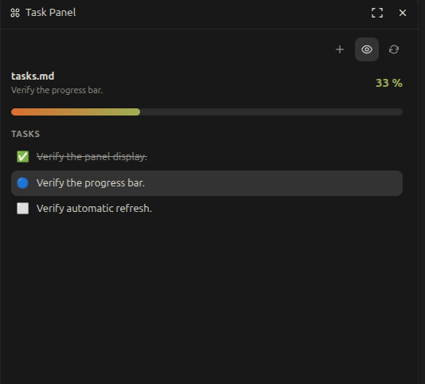

# Task Panel

OpenChamber extension that displays Markdown task plans with a visual progress bar.

[](docs/panel.png)

## Supported files

The extension searches for:

- `openspec/changes/**/tasks.md`
- `tasks.md`
- `.openchamber/tasks.md`

It understands Markdown checkboxes (`- [ ]` and `- [x]`). OpenSpec is supported by convention; no OpenSpec dependency is required.

## Install in OpenChamber

1. Open **Settings → Extensions**.
2. Paste this Git repository URL into the extension install field:

   `https://github.com/boureaujm/openchamber-taskpanel`

3. Click **Add**, approve the requested file access, then open **Task Panel** from the rail.

OpenChamber downloads the extension and keeps it up to date when a newer version is published. The repository includes the built panel bundle, so no Node, Bun, or local build step is required.

## Development

```sh
npm install
npm run build
npm test
```

Install the folder from OpenChamber Settings → Extensions. The panel polls the selected file every four seconds because the SDK does not currently expose a general file-change subscription.
