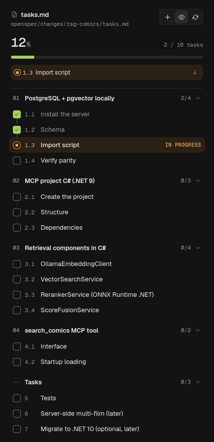
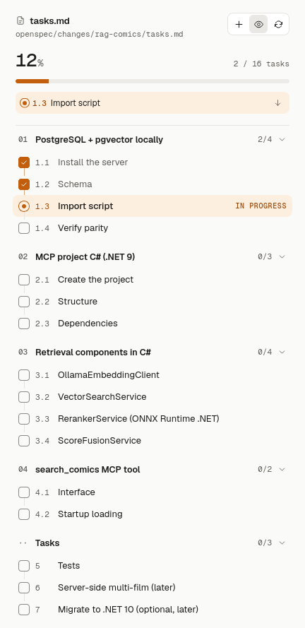

# Task Panel

OpenChamber extension that displays Markdown task plans with a visual progress bar.

<p align="center">
  
  
</p>

## Supported files

The extension searches for:

- `openspec/changes/**/tasks.md`
- `task.md` and `tasks.md`
- `.openchamber/task.md` and `.openchamber/tasks.md`

It understands Markdown checkboxes at the start of a list item (`- [ ]`, `- [x]`) and at the end of a heading (`## 1. Schema [ ]`). For headings, the parent section becomes the enclosing heading, so numbered plans like `## 1. Database` / `### 1.1 Install server [x]` keep their grouping.

## Install in OpenChamber

1. Open **Settings → Extensions**.
2. Paste this Git repository URL into the extension install field:

   `https://github.com/boureaujm/openchamber-taskpanel`

3. Click **Add**, approve the requested file access, then open **Task Panel** from the rail.

OpenChamber downloads the extension and keeps it up to date when a newer version is published. The repository includes the built panel bundle, so no Node, Bun, or local build step is required.

## Development

```sh
npm install
npm run build
npm test
```

Install the folder from OpenChamber Settings → Extensions. The panel polls the selected file every four seconds because the SDK does not currently expose a general file-change subscription.
